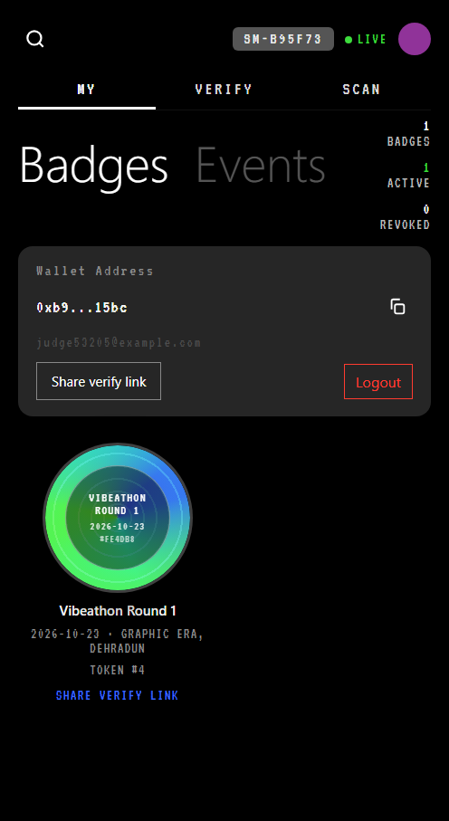
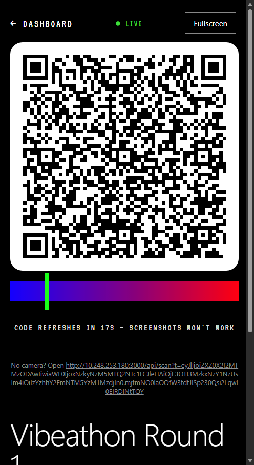
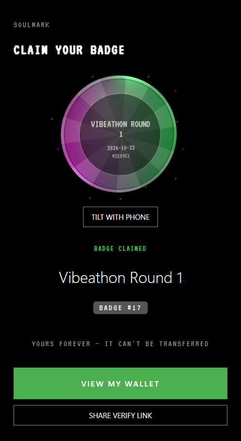
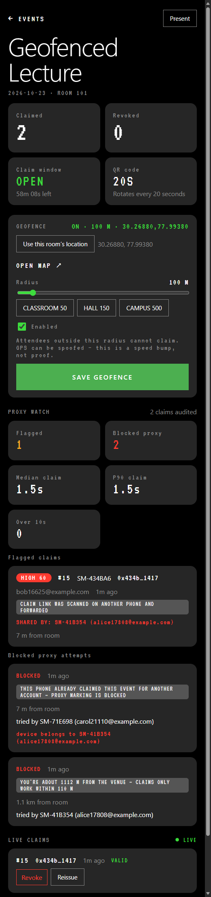
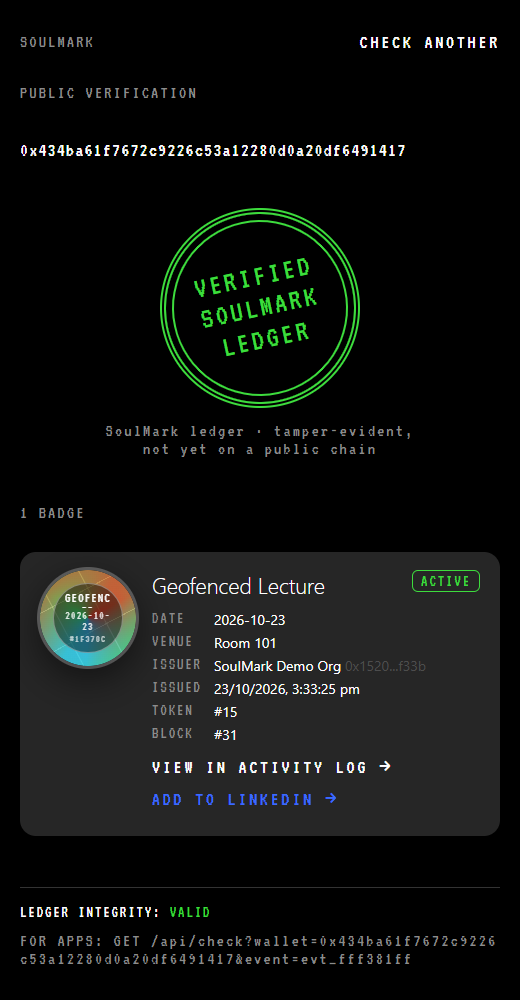
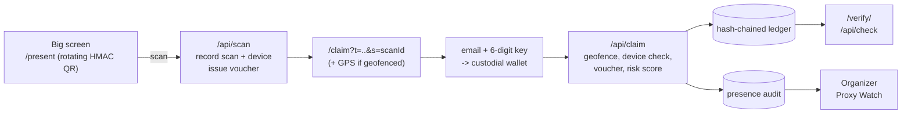

# SoulMark — proof you were there

Non-transferable (soulbound) event badges. Attendees claim them by scanning a QR **in the room**. Anyone can verify them from a link, and organizers can see who is trying to mark proxy attendance.



| Big-screen rotating QR | Claim moment (3D coin) | Organizer: geofence + proxy watch | Public verify page |
|---|---|---|---|
|  |  |  |  |

_All screenshots are captured from the running app by headless Edge (`npm run e2e`)._

## Problem
Certificates and attendance proofs are still PDFs, Google Forms and emails. They are easy to forge, easy to share with people who never came ("proxy" attendance), and hard for a recruiter or university to check. Existing on-chain badges (e.g. POAP mint links) are bearer links that get shared and farmed.

## Solution
SoulMark is a mobile-first PWA backed by a soulbound-token ledger:
- **Organizers** create an event, optionally **geofence it to the room** (pick the location + radius on the dashboard), and put a **rotating, signed QR** on the big screen. It changes every 20 s, so screenshots stop working.
- **Attendees** scan, type their email and the 6-digit key, and a **3D holographic badge** lands in their wallet. No seed phrase, no gas, no app store.
- **Proxy marking is caught:** every scan is tied to the phone that made it, so a forwarded claim link **names the person who shared it**; a phone that tries to claim the same event for a second account is **blocked and its owner identified**; every claim gets a risk score on the organizer's **Proxy Watch**.
- **Anyone** opens `/verify/<wallet>` and sees a **VERIFIED · SOULMARK LEDGER** stamp with event, issuer, date and block. Apps call `GET /api/check`.

## Round 2: what changed (judges' comments)
| Judge comment | What we built |
|---|---|
| Identify the person who shares the QR/link used for proxy | Each scan is recorded against the phone (`sm_device` cookie); the post-scan claim link carries that scan id. If it is opened on another phone, the claim is flagged **high risk** and the dashboard shows **"SHARED BY: <handle> (<email>)"**. |
| Geofencing from the organizer dashboard with a radius | Dashboard **Geofence** card: "Use this room's location", radius slider 25–1000 m (presets Classroom 50 / Hall 150 / Campus 500), live on/off. Claims outside `radius + min(GPS accuracy, 100 m)` are blocked; refusing location fails closed. |
| Detect the person who's going to mark proxy | **Hard block** when one phone claims an event for a second account (the classic proxy marker) — the attempt and the phone's owner appear under *Blocked proxy attempts*. **Risk score** per claim: forwarded link, claimed without scanning, different network from the room, slow claim, and an **early warning** for phones that keep re-scanning the QR. Median / p90 claim time is shown too. |
| 3D badges instead of 2D | three.js **3D coin** with thickness, iridescent faces carrying the deterministic art, lighting that orbits, pointer + **gyroscope tilt** (iOS permission on tap) and a fly-in spin on claim. Lazy-loaded; the CSS badge remains the fallback for no-WebGL / reduced-motion. |

## What's on-chain vs off-chain (trust model)
| Data | Where it lives today | Who can change it |
|---|---|---|
| Badges, revokes, reissues, events, geofence changes | SoulMark's **hash-chained ledger** (`data/ledger.json`); every change is a block that commits to the previous one, and `verifyChain()` replays it | Only through the API, but the **server operator** could rebuild the whole file — so it is *tamper-evident*, **not** trustless |
| Scans, devices, IPs, risk scores, blocked attempts | `data/presence.json` (off-chain audit data, organizer-only) | Server |
| Accounts, sessions, sign-in keys | `data/auth.json` | Server |
| Public blockchain | **Nothing yet.** `contracts/` holds a tested ERC-5192 contract for Base Sepolia (EIP-712 vouchers); deploying it needs a funded testnet key, and the relayer that would call it is pending | — |

The verify stamp and `/api/check` (`onChain: false`) say exactly this; the stamp will only read "on-chain" once a confirmed public-chain transaction exists.



## Threat model
| Attack | Defence | Residual risk |
|---|---|---|
| Screenshot of the QR sent to a friend | QR is HMAC-signed and dies after 30 s; geofence blocks claims from outside the room | A friend who claims within 30 s **and** spoofs GPS |
| Forwarding the claim link after scanning | Link carries the scanner's scan id → claim flagged high risk, **sharer named** on the dashboard | Allowed but flagged (organizer revokes) — by design, soft signals don't block |
| One person marking proxy for friends on their own phone | Same phone + same event + another account → **blocked**, phone owner identified | Incognito / clearing cookies resets the device id; geofence + network signals still apply |
| Remote proxy with a QR screenshot scanned on another phone | Geofence (hard), "different network from the room" signal (soft) | GPS spoofing apps |
| Badge farming with many emails | Per-IP sign-in limit (default 20 / 10 min), one claim per device per event, OTP attempt limits | Many devices / networks |
| Operator rewriting history | `verifyChain()` detects edits to blocks, tx, owners, revokes and event windows | A full rebuild of the chain by the operator — fixed by the public-chain contract (pending deploy) |
| Lost wallet / wrong person | Issuer-only revoke + single reissue | Custodial wallet; no self-recovery yet |
| Brute-forcing the organizer PIN | 10-try lockout per client IP, proxy-aware with `TRUST_PROXY` | One shared PIN |

## Features
| | |
|---|---|
| Soulbound ledger | Hash-chained, append-only ledger following ERC-5192 rules: `claim`, issuer-only `revoke` / `reissue`, `hasBadge`, `locked()` = true, `transfer()` always reverts |
| Rotating signed QR | HMAC-SHA256 payload `{eventId, iat, exp, nonce}`, rotated every 20 s and valid 30 s, exchanged for a single-use claim voucher (10 min) |
| Geofence | Per event, set from the dashboard (location + radius), haversine check at claim time |
| Proxy Watch | Sharer identification, same-phone second-account block, risk score with reasons, blocked attempts, heavy re-scanners, median/p90 claim time |
| Email + key sign-in | 6-digit key (5 attempts, 5-min expiry, resend + per-IP limits), automatic custodial wallet address. Demo mode shows the key on screen |
| 3D badge | three.js coin with deterministic art from `sha256(eventId:wallet)`, gyroscope / pointer tilt, claim fly-in; CSS fallback |
| Badge wallet | Featured 3D badge + grid, share-verify link, cached by the service worker for bad venue Wi-Fi |
| Public verify page + API | No login. Stamp, issuer, token # and block #, link to the activity log, **Add to LinkedIn**. `GET /api/check?wallet=&event=` → `{hasBadge, onChain, status, txHash}` |
| Organizer dashboard | PIN-protected: create events, presentation mode, live claim feed, revoke / reissue, geofence, proxy watch |
| Activity log | Every block and transaction with an integrity check |

## Tech stack
Next.js 16 (App Router) + TypeScript + React 19, plain CSS (design tokens from the templates), `qrcode` for QR SVGs, `three` for the 3D badge. Tests use the built-in `node --test` runner (Node 24 runs TypeScript directly). Storage is JSON files in `data/` (git-ignored). The contract lives in `contracts/` (Hardhat, OpenZeppelin v5).

```
app/            pages + api/ route handlers (claim, scan, events/[id]/geofence, events/[id]/integrity, ...)
components/     Badge (CSS), Badge3D (three.js) + lazy wrapper, service-worker registration
lib/            ledger.ts, qrToken.ts, auth.ts, geo.ts (geofence), presence.ts (proxy detection),
                stamp.ts (honest verify wording), rateLimit.ts, validate.ts, store.ts, http.ts
tests/          unit tests (ledger, QR, auth, validation, geofence, proxy detection, rate limit, stamp)
contracts/      ERC-5192 Solidity contract + Hardhat tests (not deployed yet)
scripts/        setup.mjs, smoke.sh (API journey), ui-e2e.mjs (real-browser journey)
```

## Setup
Requires Node.js 22.18+ (tested with 24.20).
```powershell
git clone https://github.com/nilay007hckkr/SoulMark.git
cd SoulMark
npm install
npm run setup      # creates .env with a random ORGANIZER_PIN and QR_SECRET
```

## Run
```powershell
npm run build
npm start          # http://localhost:3000 and http://<LAN-IP>:3000
```
`run.cmd` (Windows) installs, builds and starts in one go. Use `npm run dev` for hot reload. Phones on the same Wi-Fi can scan the QR directly (it encodes the LAN IP; override with `PUBLIC_BASE_URL`). **Geolocation, the in-app scanner and the service worker need HTTPS** on phones: put the app behind an HTTPS tunnel, set `PUBLIC_BASE_URL=https://…` and `TRUST_PROXY=true`.

Demo: `/organizer` → PIN → create event → set geofence → **PRESENT** → scan with a phone → email + key → 3D badge → **Share verify link**; forward the claim link to a second phone and watch **Proxy Watch** name the sharer.

## Database
- **Engine and location:** SQLite via `better-sqlite3`. The file is `data/app.db`; set `DB_PATH` to change it. `data/` and `*.db*` are git-ignored.
- **Creation:** on first use the server creates the folder and the schema (`CREATE TABLE IF NOT EXISTS`), with WAL mode, `foreign_keys=ON`, and indexes on lookup columns.
  - Ledger tables: `blocks`, `txs`, `events`, `badges`, `used_nonces`
  - Account tables: `users`, `otps`, `sessions`
  - Proxy-detection tables: `scans`, `claims`, `blocked_attempts`
  - Generated secrets: `meta`
- **Code layout:** all SQL lives in `lib/db.ts` and uses parameterized statements only. Route handlers go through `lib/store.ts`.
- **Seeding:**
  - If the database is empty, it is seeded with the genesis block and the demo event "Vibeathon Round 1".
  - If `data/*.json` files from the older JSON storage exist, they are imported once and renamed to `*.json.imported`.
- **Reset:** stop the server, delete `data/app.db`, `data/app.db-wal` and `data/app.db-shm`, then start again. A fresh seeded database is created. Also delete any leftover `data/*.json.imported` files if you don't want them kept around.
  ```powershell
  Remove-Item data\app.db, data\app.db-wal, data\app.db-shm -ErrorAction SilentlyContinue
  ```

## Test
```powershell
npm test                    # 35 unit tests
npx tsc --noEmit -p .       # type check
npm run smoke               # API journey incl. geofence + proxy scenarios (needs a running server; uses bash)
npm run e2e                 # real-browser journey in headless Edge/Chrome (BROWSER_PATH to override)
cd contracts; npm install; npm test   # Solidity contract tests
```
CI (`.github/workflows/ci.yml`) runs typecheck, unit tests, a production build and the contract tests.

## Honest limitations
- Badges are on SoulMark's tamper-evident ledger, **not yet on a public blockchain**; the contract is written and tested but not deployed (needs a funded testnet key + relayer).
- Demo mode shows the sign-in key on screen; Google sign-in and real email delivery need credentials (pending).
- GPS can be spoofed and device ids reset with incognito — geofence and device checks are speed bumps, combined with the risk score and organizer review.
- One organizer PIN; single-process JSON storage.

See [summary.md](summary.md) and [docs/overview.md](docs/overview.md) for decisions, the Round 2 change log and the full list of limitations. Licensed under MIT.
